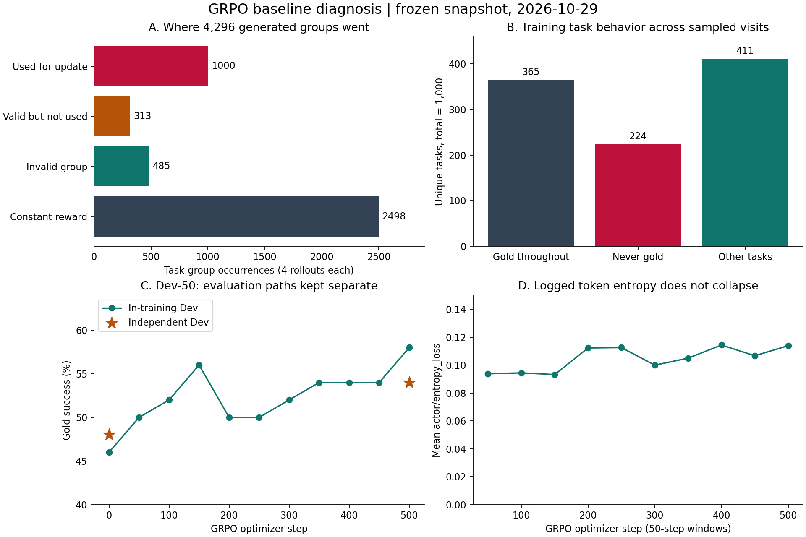

# GRPO 复现结果分析：基于已同步的真实产物

分析日期：2026-10-29。对应上游 `a583dba`、SFT step300、GRPO step500。本文取代此前诊断文档中的待验证推测；原始实验记录和评分均保留。

**结论：本轮 GRPO 有真实的行为改善，但主要短板仍是候选利用、细粒度规格选择与购买前状态核对。训练同时受到大量无差异采样、部分无 gold 解任务和策略错误被过滤的影响。现有证据不支持把主因归为熵崩溃、PPO clip 太紧或普遍过小的优势。局部决策信用分配值得研究，但尚未被证明是小增益的唯一原因。**

## 1. 输入文件核对通过

输入为 `analysis/grpo_baseline_20261022_202816/` 中的 11 份统计、配置及独立 Dev 轨迹，另有清单和源码补丁。

- 11 份内容都匹配云端 SHA-256：4 份直接匹配，7 份仅发生 Windows CRLF 换行转换，归一化为 LF 后匹配。没有内容损坏证据。
- SFT、GRPO 独立 Dev 各 50 条，task_id 唯一且集合相同；全部汇总字段可由轨迹重新算出。
- 两份独立评测 protocol 仅模型服务名称不同，任务文件、温度、步数、生成长度、上下文和 observation 配额一致。
- 有效更新为旧日志 1–350 + 续跑 351–500，恰好 500 次。回滚的旧 351–358 没有混入主统计；对应 208 条采样另列成本。
- 两段封存配置的差异仅为恢复、输出/记录名称和开始前验证等预期项，未发现学习率、batch、奖励或 LoRA 等意外变化。
- 用本地固定 Reward v3 纯函数复算了两份 Dev 里的 **94 次购买**，奖励类型与标量奖励全部匹配。此检查不加载模型、不启动环境，不等同于完整在线重放。

详细结果见 [derived/evidence.json](analysis/grpo_baseline_20261022_202816/derived/evidence.json)。没有读取你手动下载的“分析产物”目录，也没有新增读取 Final 原始轨迹。

## 2. 同口径的 Dev 改善是 48% → 54%，不是 46% → 58%

| 独立 Dev-50 | SFT | GRPO |
| --- | ---: | ---: |
| 严格成功 | 24/50（48%） | 27/50（54%） |
| 平均 Reward | 0.37968 | 0.43230 |
| 平均工具步数 | 8.94 | 8.96 |
| 部分满足购买 | 18 | 14 |
| 循环 | 2 | 4 |
| 错误购买 | 4 | 3 |
| 奖励不可核验 | 2 | 2 |
| Guard 拒绝次数 | 3 | 5 |

逐题配对为：共同成功 24、仅 GRPO 成功 3、仅 SFT 成功 0、共同失败 23。新增成功来自 `5293 / 7086 / 10077`。双侧 exact McNemar `p=0.25`，小样本不足以证明稳定优势；也不能把 0 个成功回退解读为所有行为都没退化。

例如两题由 partial 变为循环，一题由错误购买变为循环；这些变化没有改变“是否严格成功”，却改变了执行质量。50 题中只有 25 题动作序列完全相同，不能根据成败大多不变就说策略没更新。

训练内 Dev 是 23/50 → 29/50，属于另一条 harness。相同端点在独立路径是 24/50 → 27/50。因此原来“Dev 提升 12 点，Final 只提升 1.5 点”的比较混入了路径差异和小样本选模效应。独立 Dev 的提升实际为 6 点，仍高于已记录的 Final 1.5 点，但当前证据不足以唯一归因为过拟合或导出错误。

训练内候选成功数为 `23,25,26,28,25,25,26,27,27,27,29`（step0、50、…、500），有波动，不能据此断言越训越好。不能用已知 Final 成绩重新挑 checkpoint。

## 3. 三个新增成功揭示了模型实际学到了什么

| 任务 | SFT → GRPO 的关键变化 | 解释与限制 |
| --- | --- | --- |
| 10077，电瓶车延长线 | 同一商品，将“三脚、3米”改为“两脚、3米” | 明确的细粒度规格改进，直接对应用户“两片扁插头”要求 |
| 7086，风送投料机 | 在第一个候选后继续返回搜索，换到合适商品并选规格 | 候选比较与搜索恢复改善；因此不应统一惩罚增加的步数 |
| 5293，犬用处方粮 | 同一商品、同一主规格，购买前补选唯一的 `0lb` 净含量轴 | 在当前评分下补齐了规格；`0lb` 本身提示数据字段异常，不能把此题简单解释为真实购物理解大幅提高 |

这三题是机制线索，不是局部信用分配已经被验证有效的实验。

## 4. 失败主要发生在候选和规格决策，不全是检索不到

GRPO 仍失败 23 题：14 partial、4 循环、3 错误购买、2 不可核验。

- **18/23** 的 gold ASIN 曾在模型可见 observation 中出现，其中 10 题打开过 gold，8 题看到但没打开。
- 5 题的 gold 没在本次可见轨迹中出现：`652 / 8107 / 13399 / 16263 / 23126`。这不证明检索器永远无法召回，只说明这次策略没找到。
- 14 道 partial 中，13 道存在规格维度不满足，9 道同时存在功能维度不满足；这些维度重叠，不能相加。
- 5 道 partial 最终购买的已经是 gold ASIN，因此有很具体的规格决策改进空间。

### 清楚可归因的局部错误

| 任务 | 可见证据和执行结果 | 更直接的短板 |
| --- | --- | --- |
| 3485，外套 | 用户要白色“标准款式”，当前商品同时有“米白色”和“米白色常规”，选择前者 | 未绑定款式要求 |
| 8666，压脚 | 用户要“买10送1”，页面明确有该选项，最终却选“1个” | 数量/套餐规格错误 |
| 14156，靴子 | 用户要海豚黑、宽松鞋型，页面有“海豚黑（宽版）”，最终选普通“海豚黑” | 漏掉复合规格中的宽版要求 |
| 12066，翻译机 | 上限250元，模型将299元规格改为276元规格后仍购买；便宜规格S10可选 | 已见最终价格，却未完成预算核对 |
| 2718，水冷头 | 打开正确商品，黑色规格清楚可选，直接购买且 options 为空 | 必要规格轴漏选 |
| 16252，投料机 | 打开正确商品，明确列出多个规格，直接购买且 options 为空 | 必要规格轴漏选 |

但**不能把全部规格扣分都当成清楚的模型错误**。12703 的用户说明宽3米、高2.7米和可改短，却未明确“打孔/挂钩”，隐藏标注强制要求“打孔”，模型选了“挂钩”。7061 还要求点击“下单勿使用号码保护”等隐藏规格轴。此类样本同时涉及任务语义和标注契约，应单独审阅。

### 循环不是纯粹的步数问题

4 道循环中，gold 都出现过。4128 甚至已打开正确商品，但反复选“500g-20瓶”“500g-10瓶”，面对超预算又重新搜索，没选择页面上的“500g-1瓶”；19606 反复打开同一个48寸商品，而用户要42寸。这里更值得学习的是回到已见证据、选择其他候选/规格及识别没有进展，而不是给所有额外步骤扣分。

**离线反事实上界**：最终已购买 gold 的9道失败中，8道在同一商品上改为正确规格可得 gold，另1道14929存在预算矛盾。这个8题是使用隐藏答案得出的上界，不代表新算法一定能多成功8题，也不能把答案作为策略输入。

完整逐题证据见 [dev_failure_review.json](analysis/grpo_baseline_20261022_202816/derived/dev_failure_review.json)，成败与首次动作分叉见 [dev_paired.csv](analysis/grpo_baseline_20261022_202816/derived/dev_paired.csv)。

## 5. 新发现：部分训练任务在当前奖励契约下没有 gold 解

对训练1000题及Dev50题执行了静态审计：取对应 gold 商品及标注规格，用固定 Reward v3 计算奖励；对非满分样本进一步枚举未规定规格轴的全部值及“不选”情况。每题设10000组合上限，所有异常样本均完成搜索，最多只需48次计算。商品任务索引还与全部50道Dev的实际Query核对一致。

| 标注 gold 的离线结算 | 训练1000题 | Dev50题 |
| --- | ---: | ---: |
| gold_purchase | 910 | 48 |
| wrong_purchase | 44 | 2 |
| reward_unverifiable | 32 | 0 |
| partial_alternative_purchase | 14 | 0 |

这90道训练题即使按标注选购，也无法在固定商品/奖励契约下得到 gold；枚举剩余规格没有找到补救组合。在实际17184条训练采样中，这90题也全都从未采到 gold。它们占224个“从未采到 gold”任务的约40.2%。其中34题进入过更新，累计65个任务组，占全部已训练组的6.5%。

Dev 的两个例子：

- 652：用户说“预算500块左右”，函数提取上限500，gold指定颜色规格价格523，结算wrong。
- 14929：用户说“预算20块左右”，上限20，gold唯一规格22；模型买对商品、选对规格，仍结算wrong。不同句式中的“左右”没有得到一致容差处理。

另有预算提取遗漏：12703 的“三百三十元”、20134 的“不得超出160元”等在记录中变成 `price_upper=null`。这些例子不必都造成当前成败变化，但说明奖励要求与自然语言需求并不完全一致。

上述90题不是“完全没有学习价值”：它们仍可提供部分满足、减少循环等信号。但无法提供严格成功正例，会限制有效比较并污染按成功率进行的难度估计。**这还不足以单独解释所有小增益**，因为它们只占6.5%的已训练组，而且没有审计整个Final。

审计不改变原版成绩，不删除失败题，不把成功率分母改成48或910。若后续修正数据或奖励，需要作为新实验条件，对原版GRPO和改进版公平使用同一规则。目标/标注仅用于离线诊断，不能向推理策略泄漏。

## 6. 正式训练的采样利用率低，但需要正确解释

| 4296个生成组的去向 | 组数 | 占生成组 |
| --- | ---: | ---: |
| 奖励同分而过滤 | 2498 | 58.1% |
| 含无效轨迹而过滤 | 485 | 11.3% |
| 有奖励差异，但未最终用于更新 | 313 | 7.3% |
| 真正进入更新 | 1000 | 23.3% |

对应生成17184条，实际训练4000条，跳过更新341次。加上回滚采样后，两份输入日志共17392条，最终链的训练消费比约23.0%；这些数不含最初OOM运行、Dev验证等项目成本。

313个“有差异却未训练”的组中，68组生成时已凑满batch而未接收，245组虽暂存但后来因补采预算耗尽、凑不齐两个有效组而被清空。这是有条件可以减少的采样浪费，但是否提高最终成功率仍需对照实验。

1000题都被采样过，474题进入更新，526题未进入。**不能说526题都是被忽略的难题**：其中365题在全部采样中一直为gold，本就缺少相对改进信号。224题从未采到gold，其中118题仍进入过更新；扣除90道静态无gold解任务后，尚有134题具备gold解、却没有在本次采样中找到。

已训练1000个组中，666组含gold成功/失败混合，334组没有gold。后者可以教模型改善失败质量，但不直接提供成功轨迹对照。训练收益有限更接近“部分难题的成功探索与局部决策学习不足”，而不是“所有训练都没有成功信号”。

## 7. 一个值得单独改进的过滤盲区

`reward_valid=false` 会将 `reward_unverifiable` 标为采样无效，动态采样再过滤整个组。但2718、16252展示了另一种情形：商品和价格信息本身可用，**是策略直接购买、没有选择必要规格，才导致价格无法核验**。

这种策略造成的未完成状态，不等同于环境服务故障或商品元数据缺失。当前统一过滤可能使“选规格前就买”缺少直接负反馈。训练中551条轨迹被记为reward_unverifiable，相关过滤原因出现在240个组中；但现有汇总没有逐条原因，不能宣称551条全是漏选规格。另有268个组出现泛化的reward_sampling_invalid原因，可能与上述组重叠，不能相加当总数。

后续应区分“模型漏选必要轴”“元数据本来无法定价”“执行/基础设施异常”。不要简单将所有不可核验结果改成负分。该区分可以先在原始训练日志/环境证据上审计，再决定保留哪些有效的失败轨迹。

## 8. 可以降低优先级的假设

| 原假设 | 新证据 | 判断 |
| --- | --- | --- |
| 已保留组普遍优势很小 | 已训练组平均中心化绝对奖励差0.416，中位0.402，最小约0.0129 | 不支持作为主因；奖励差不等于梯度，但不是此前±0.005示例所描述的普遍状态 |
| 同组动作几乎相同 | 保留组平均3.846/4种动作序列，中位数4 | 不支持“完全无探索”；仍可能只改变无关动作，不能据此证明有效探索充分 |
| RL过程熵崩溃 | 前100步平均0.0941，最后100步0.1103 | 当前被记录样本中未见熵崩溃；不是固定任务上的熵对照，也不能排除SFT早已低熵 |
| clip过紧限制探索 | 全部更新平均clip fraction约0.001282，即0.128%，各窗口都很低 | 没有优先采用Clip-Higher的依据 |
| 梯度完全没生效 | 梯度范数平均约0.279，独立轨迹已有行为变化 | 不支持“根本没训练”；仍不能证明学习率和更新预算已最优 |
| 主要是上下文超限 | 独立Dev两版均无上下文超限，全部正常结束 | 不是当前Dev的主要瓶颈；不能据此推断Final和全部训练轨迹 |

`actor/ppo_kl≈0.0065` 是当前更新/rollout概率之间的框架指标，**不是相对SFT参考模型的KL**，不能据此证明模型没有长期漂移。平均policy loss正负受组内中心化与token权重影响，也不能像SFT loss一样直接解释成能力提升曲线。

## 9. 对下一步研究方向的建议

1. **先固定本轮诊断，不动原基线成绩。** 为90道训练任务和明确的Dev语义歧义建立审阅清单；先用训练任务设计通用一致性检查，避免针对某几个Dev ID硬编码。保留原协议的完整结果。
2. **为算法研究选择可验证的规格决策子问题。** 优先研究“已到达合适商品，如何把剩余需求绑定到规格并正确购买”，因为这里有明确可见证据、成功与失败动作和可离线核验的结果。
3. **先测分叉可行性，再决定改算法。** 在训练任务中固定同一商品页面和共同前缀，从规格选择/购买前状态采样后缀。检查能否产生不同的、语义合理的可核验结局；只有后缀参与更新，工具返回与共同前缀保持mask约定。不要向策略提供gold ASIN或目标规格答案。
4. **对照分开做。** 同一SFT起点、同一任务和奖励契约下，先比较原版GRPO与一次明确改动。若要同时修数据/奖励/采样和分叉信用分配，就至少有“仅修基础问题”这一对照，否则收益无法归因于算法。
5. **按生成成本控制预算。** 本轮只比500个optimizer step会掩盖约4.3倍的生成批次成本。对照应记录总rollout、生成/训练token、GPU时长，并保留有效组和任务覆盖指标。

现阶段不建议直接换大模型、全参训练、统一步数惩罚、提高clip上界或笼统增大学习率。更适合的研究假设是：**在语义和奖励一致的任务上，对已找到候选的规格/购买分叉提供更局部的成功比较，是否比整条轨迹共享优势更省采样、更能修复明确的局部错误？** 当前分析支持开展此实验，不等于已经证明它会提高Final成功率。

## 10. 复现本次分析

在父仓库运行：

```bash
python tools/analyze_grpo_results.py
```

脚本需要PyYAML；图表依赖Matplotlib，缺少时跳过绘图。它读取冻结快照和上游纯奖励模块，输出 `derived/` 中的配对表、50步窗口、逐题证据、1050题静态审计和概览图。没有修改训练源码、模型、任务清单、奖励规则或原始快照。


